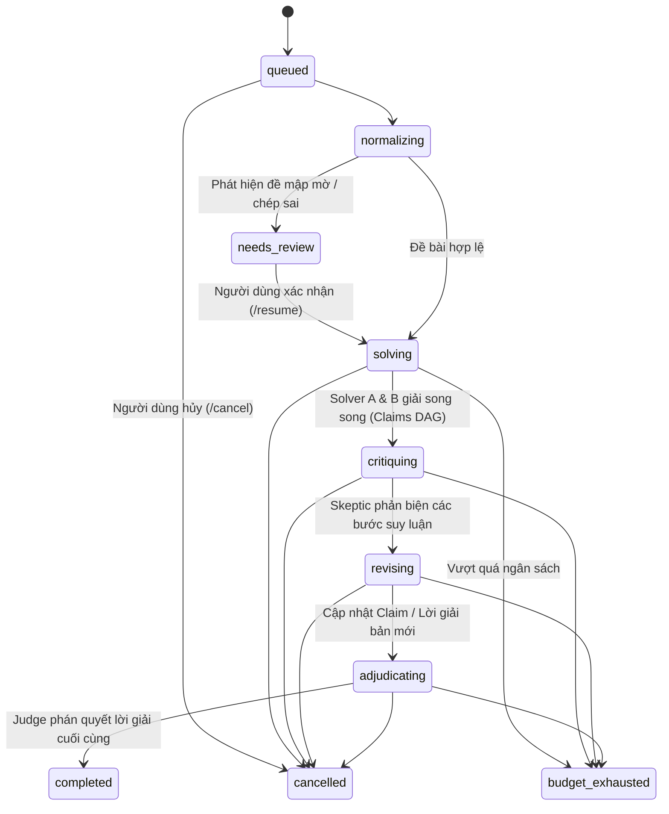

# Math Council — Hội Đồng Tranh Luận Toán Học AI (Bước 3: Multi-Agent & Orchestrator)

Dự án **Math Council** là nền tảng giải toán nâng cao dựa trên mô hình **Hội đồng AI đa tác nhân tranh biện và đồng thuận (Multi-Agent Debate & Consensus)**. 

Hệ thống mô phỏng một hội đồng học thuật toán học độc lập, gồm các vai trò chuyên biệt: Chuẩn hóa đề bài (**Normalizer**), Giải toán độc lập song song (**Solver A** & **Solver B**), Phản biện logic gắt gao (**Skeptic**), Hoàn thiện lời giải (**Reviser**), và Thẩm định phán quyết chung khảo (**Judge**).

---

## 1. Kiến Trúc Hệ Thống Bước 3 (Modular Monolith + Async Worker)

```mermaid
graph TD
    User["Người dùng / Trình duyệt"]
    Web["apps/web (Next.js 14 App Router + SSE)"]
    API["services/api (FastAPI HTTP Endpoints)"]
    Worker["services/api (Async Worker / Orchestrator)"]
    Redis[("Redis 7 Alpine (Pub/Sub & Event Stream)")]
    DB[("PostgreSQL 16 Database (11 Bảng)")]

    User -->|Port 3000| Web
    Web -->|Rewrites /api/v1 & SSE| API
    API -->|Enqueue Runs| DB
    API -->|Stream Events (SSE)| Redis
    Worker -->|State Machine Pipeline| DB
    Worker -->|Publish Events| Redis
    API -->|Port 8000 / asyncpg| DB
```

### Luồng Hoạt Động Của Hội Đồng (Agent State Machine):


---

## 2. Các Đặc Tính Kỹ Thuật Trọng Tâm (Strict Guardrails)

1. **Orchestrator tập trung (No Peer-to-Peer Agent Communication):**
   - Các Agent tuyệt đối không gọi trực tiếp lẫn nhau; mọi giao tiếp đi qua State Machine và lưu trữ trong bảng `messages` và `model_calls`.
2. **Kiểm tra chu trình Đồ thị Mệnh đề (DAG Cycle Detection):**
   - Mọi lời giải được phân rã thành các mệnh đề `C1, C2,...` kèm danh sách phụ thuộc `depends_on`.
   - Thuật toán DFS phát hiện chu trình (Tarjan/DFS with recursion stack) trong `app/claims/dag_validator.py` đảm bảo không xảy ra ngụy biện suy luận vòng tròn.
3. **Quản lý Ngân sách Chặt chẽ (Atomic Budget Reservation):**
   - `app/budget/manager.py` quản lý giữ chỗ ngân sách (`reserved_cost_usd`) trước khi gọi LLM đồng thời, tránh race condition khi Solver A và B chạy song song.
   - Khi `actual_cost_usd + reserved_cost_usd + call_cost > budget_usd`, hệ thống lập tức dừng và chuyển trạng thái sang `budget_exhausted`.
4. **Phòng chống Prompt Injection & Versioning:**
   - Mọi prompt được gán phiên bản bất biến (`PROMPT_VERSION = "v3.0.0"`).
   - Dữ liệu đề bài của người dùng được đóng gói bên trong thẻ phân tách dữ liệu an toàn `<problem_statement>` để ngăn chặn tấn công Prompt Injection.
5. **Real-time Server-Sent Events (SSE):**
   - Kết nối trực tiếp qua Redis Pub/Sub kênh `run:{run_id}:events`, đẩy cập nhật trạng thái, mệnh đề, phản biện và chi phí về giao diện người dùng theo thời gian thực.

---

## 3. Danh Sách 11 Bảng Cơ Sở Dữ Liệu

1. `problems`: Đề toán gốc và đề toán chuẩn hóa.
2. `runs`: Phiên giải toán của hội đồng (trạng thái, ngân sách, chi phí thực tế).
3. `run_agents`: Cấu hình vai trò agent và model tương ứng cho từng phiên.
4. `messages`: Lịch sử các trao đổi và phản hồi của các Agent trong hội đồng.
5. `solutions`: Các phiên bản lời giải của Solver A, Solver B và bản sửa chữa.
6. `claims`: Từng mệnh đề toán học (loại mệnh đề, trạng thái xác thực: `unverified`, `supported`, `disputed`, `rejected`).
7. `claim_dependencies`: Quan hệ phụ thuộc giữa các mệnh đề để tạo DAG.
8. `challenges`: Các phản biện từ Skeptic (phân loại lỗi: `invalid_inference`, `missing_case`, `unsupported_claim`, v.v.).
9. `challenge_events`: Lịch sử audit thẩm định phản biện (`open -> accepted / rejected`).
10. `model_calls`: Nhật ký chi tiết token (prompt, completion), chi phí USD, độ trễ và phiên bản prompt.
11. `final_reports`: Báo cáo thẩm định chung khảo của Judge, điểm tin cậy và lời giải LaTeX hoàn chỉnh.

---

## 4. Danh Sách API Endpoints (`/api/v1`)

| Endpoint | Method | Trạng thái | Mô tả |
| :--- | :---: | :---: | :--- |
| `/health` | GET | 200 | Kiểm tra kết nối cơ sở dữ liệu (`SELECT 1`). |
| `/api/v1/models` | GET | 200 | Danh sách các LLM model khả dụng trong hệ thống. |
| `/api/v1/problems` | GET / POST | 200 / 201 | Danh sách bài toán & Tạo bài toán mới (bảo toàn LaTeX). |
| `/api/v1/problems/{id}` | GET | 200 | Chi tiết bài toán và danh sách các Runs. |
| `/api/v1/problems/{id}/runs` | POST | 202 | Khởi tạo phiên giải toán mới (`queued`). |
| `/api/v1/runs/{id}` | GET | 200 | Trạng thái và chi tiết một phiên giải toán. |
| `/api/v1/runs/{id}/cancel` | POST | 200 | Hủy phiên giải toán đang chạy (`status -> cancelled`). |
| `/api/v1/runs/{id}/resume` | POST | 200 | Tiếp tục phiên giải toán ở trạng thái `needs_review`. |
| `/api/v1/runs/{id}/events` | GET | 200 | Stream Server-Sent Events (SSE) theo dõi trực tiếp. |
| `/api/v1/runs/{id}/messages` | GET | 200 | Lịch sử trao đổi giữa các Agent trong hội đồng. |
| `/api/v1/runs/{id}/solutions` | GET | 200 | Danh sách các phiên bản lời giải và các Claims (DAG). |
| `/api/v1/runs/{id}/challenges`| GET | 200 | Danh sách phản biện của Skeptic và lịch sử audit. |
| `/api/v1/runs/{id}/report` | GET | 200 | Báo cáo phán quyết cuối cùng của Thẩm phán (Judge). |
| `/api/v1/runs/{id}/usage` | GET | 200 | Thống kê số lượng token, chi phí và độ trễ từng Agent. |

---

## 5. Khởi Chạy Toàn Bộ Hệ Thống Bằng Docker Compose

Toàn bộ hệ thống gồm 5 containers: `db`, `redis`, `api`, `worker`, `web`.

```bash
docker compose up -d --build
```

### Các cổng dịch vụ:
- **Giao diện Web Frontend**: [http://localhost:3000](http://localhost:3000)
- **Backend API**: [http://localhost:8000](http://localhost:8000)
- **Tài liệu API tương tác (Swagger UI)**: [http://localhost:8000/docs](http://localhost:8000/docs)
- **Kiểm tra sức khỏe (Health Check)**: [http://localhost:8000/health](http://localhost:8000/health)
- **PostgreSQL**: `localhost:5432`
- **Redis**: `localhost:6379`

---

## 6. Chạy Bộ Kiểm Thử Tự Động (40/40 Pytest PASS 100%)

Toàn bộ logic được kiểm thử tự động toàn diện:
- `tests/test_api.py` & `tests/test_api_step2.py`: Kiểm thử API Bước 2.
- `tests/test_dag_validator.py`: Kiểm thử kiểm tra chu trình DAG (chu trình 2 đỉnh, 3 đỉnh, tự tham chiếu, thiếu phụ thuộc).
- `tests/test_budget_and_gateway.py`: Kiểm thử bảo vệ chống Prompt Injection, Deterministic Mock LLM, kiểm soát ngân sách và lỗi `BudgetExhaustedError`.
- `tests/test_orchestrator_flow.py`: Kiểm thử toàn bộ luồng hội đồng, phân nhánh `needs_review`, lệnh `cancel`, và cạn kiệt ngân sách.
- `tests/test_api_step3.py`: Kiểm thử đầy đủ 9 endpoints mới và stream SSE.

### Lệnh chạy kiểm thử:
```bash
# Chạy bên trong container api
docker compose exec api pytest -v

# Hoặc chạy cục bộ trên máy host
cd services/api
python -m pytest -v
```

### Kiểm tra build Frontend Next.js:
```bash
cd apps/web
npm run build
```

---

## 7. Cấu Trúc Thư Mục Dự Án

```
math-council/
├── apps/
│   └── web/                         # Frontend Next.js 14 App Router
│       ├── app/
│       │   ├── page.tsx             # Trang chủ giới thiệu & bài toán gần đây
│       │   ├── layout.tsx           # Khung layout chung
│       │   ├── globals.css          # TailwindCSS & KaTeX styles
│       │   ├── problems/
│       │   │   ├── page.tsx         # Danh sách toàn bộ bài toán
│       │   │   ├── new/page.tsx     # Form tạo đề (Live LaTeX Preview 2 cột)
│       │   │   └── [id]/page.tsx    # Chi tiết đề bài & danh sách các Runs
│       │   └── runs/
│       │       └── [id]/page.tsx    # Phòng Hội đồng: Live SSE, State Machine, 4 Tabs
│       ├── components/
│       │   └── MathRenderer.tsx     # Component kết xuất công thức KaTeX an toàn
│       ├── lib/
│       │   └── api.ts               # Typed API Client cho toàn bộ Step 2 & Step 3
│       ├── Dockerfile
│       └── next.config.mjs
├── services/
│   └── api/                         # Backend API & Worker Engine (FastAPI)
│       ├── app/
│       │   ├── budget/              # Quản lý ngân sách và giữ chỗ in-flight
│       │   │   └── manager.py
│       │   ├── claims/              # Thuật toán kiểm tra chu trình DAG
│       │   │   └── dag_validator.py
│       │   ├── discussion/          # Động cơ quản lý phiên bản Lời giải & Phản biện
│       │   │   └── engine.py
│       │   ├── events/              # Redis Pub/Sub & Mock Event Publisher
│       │   │   └── publisher.py
│       │   ├── llm_gateway/         # Gateway hỗ trợ Mock, OpenAI, Gemini
│       │   │   ├── base.py
│       │   │   ├── mock_adapter.py
│       │   │   ├── openai_adapter.py
│       │   │   └── gemini_adapter.py
│       │   ├── models/              # SQLAlchemy 2.0 Base & 11 Tables
│       │   │   ├── problem.py
│       │   │   ├── run.py
│       │   │   └── step3_models.py
│       │   ├── orchestrator/        # State Machine điều phối toàn bộ Hội đồng
│       │   │   └── state_machine.py
│       │   ├── prompts/             # Prompt có version và thẻ chống Injection
│       │   │   └── templates.py
│       │   ├── repositories/        # Tầng truy vấn DB độc lập
│       │   │   ├── problem_repo.py
│       │   │   └── run_repo.py
│       │   ├── routes/              # FastAPI Router v1 (problems, runs, models)
│       │   │   ├── problems.py
│       │   │   ├── runs.py
│       │   │   └── models.py
│       │   ├── schemas/             # Pydantic v2 Contracts & Schemas
│       │   │   ├── problem.py
│       │   │   ├── run.py
│       │   │   ├── agent_contracts.py
│       │   │   └── step3_schemas.py
│       │   ├── main.py              # FastAPI app & Global Exception Handlers
│       │   └── worker.py            # Entrypoint tiến trình Worker
│       ├── alembic/                 # Migrations (0001_initial & 0002_step3)
│       ├── tests/                   # 40 bài kiểm thử tự động
│       ├── Dockerfile
│       └── pyproject.toml
├── docker-compose.yml               # Cấu hình db, redis, api, worker, web
├── AUTO_RUNNER_QUEUE.md             # Hàng đợi thực thi tự động (100% Completed)
├── STEP2_AGENT_PLAN.md              # Kế hoạch chi tiết Bước 2
├── STEP3_AGENT_PLAN.md              # Kế hoạch chi tiết Bước 3
├── railway.md                       # Cẩm nang triển khai 100% tin cậy trên Railway.app
└── README.md                        # Hướng dẫn kiến trúc, sử dụng và nghiệm thu
```

---

## 8. Hướng Dẫn Triển Khai Lên Railway.app

Chi tiết các bước thiết lập được trình bày trong [railway.md](file:///c:/Antigravity/math-council/railway.md).

### Lệnh Khởi Chạy (Start Commands) Cho Từng Dịch Vụ Trên Railway:

1. **Service `api` (Backend FastAPI):**
   - **Start Command**: Sử dụng lệnh mặc định trong Dockerfile:
     ```bash
     sh -c "alembic upgrade head && uvicorn app.main:app --host 0.0.0.0 --port ${PORT:-8000}"
     ```
2. **Service `worker` (Council Orchestrator Background Worker):**
   - **Custom Start Command (Bắt buộc điền trên Railway Settings)**:
     ```bash
     python -m app.worker
     ```
   *(Lưu ý: Không chạy lại `alembic upgrade head` trên worker để tránh race condition database lock với `api`).*
3. **Service `web` (Frontend Next.js 14):**
   - **Start Command**:
     ```bash
     sh -c "npx next start -H 0.0.0.0 -p ${PORT:-3000}"
     ```

