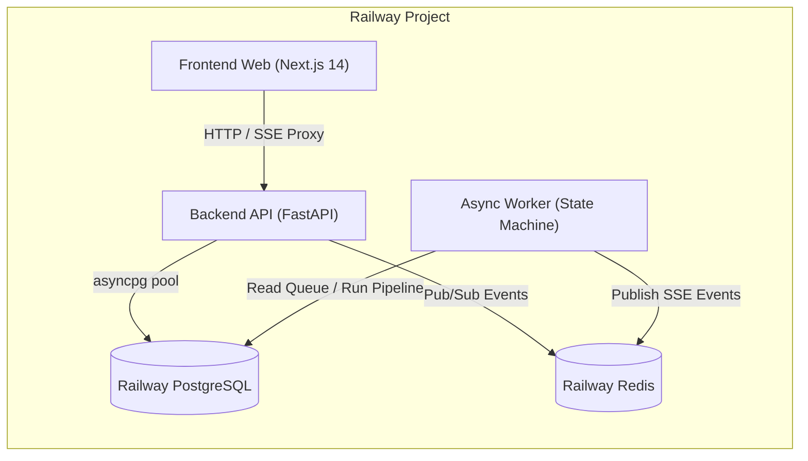

# Hướng Dẫn Triển Khai Math Council Lên Railway.app

Tài liệu này hướng dẫn chi tiết cách triển khai toàn bộ hệ thống **Math Council (Multi-Agent Math Debate Platform)** lên Railway.app với độ tin cậy 100%.

---

## 1. Kiến Trúc Dịch Vụ Trên Railway

Hệ thống bao gồm 5 dịch vụ (services):



| Service | Loại | Dockerfile / Image | Cổng (Port) | Vai trò |
| :--- | :--- | :--- | :--- | :--- |
| **PostgreSQL** | Plugin | `postgres:16` | 5432 | Lưu trữ 11 bảng dữ liệu, Problems, Runs, DAG Claims |
| **Redis** | Plugin | `redis:7` | 6379 | Message Broker cho Task Queue và Pub/Sub SSE |
| **api** | App | `services/api/Dockerfile` | `${PORT:-8000}` | FastAPI REST Endpoints, migration DB, SSE Stream |
| **worker** | App | `services/api/Dockerfile` | N/A | Worker nền chạy Council State Machine giải toán |
| **web** | App | `apps/web/Dockerfile` | `${PORT:-3000}` | Next.js 14 Web UI, KaTeX math renderer, Route Proxy |

---

## 2. Lệnh Khởi Chạy (Start Commands) Chi Tiết

> [!IMPORTANT]
> **Quy tắc An toàn Cực kỳ Quan trọng:**
> Dịch vụ `worker` **tuyệt đối không chạy lại** `alembic upgrade head` khi khởi động để tránh xung đột khoá cơ sở dữ liệu (Race Condition Database Lock) với dịch vụ `api`.

### Dịch vụ `api` (Backend FastAPI)
- **Root Directory**: `services/api` (hoặc cấu hình Dockerfile trỏ tới `services/api/Dockerfile`).
- **Start Command**: Sử dụng lệnh mặc định trong Dockerfile (không cần ghi đè):
  ```bash
  sh -c "alembic upgrade head && uvicorn app.main:app --host 0.0.0.0 --port ${PORT:-8000}"
  ```

### Dịch vụ `worker` (Async Discussion Engine Worker)
- **Root Directory**: `services/api` (dùng chung source và Dockerfile với `api`).
- **Start Command (Bắt buộc điền vào Railway Custom Start Command)**:
  ```bash
  python -m app.worker
  ```

### Dịch vụ `web` (Frontend Next.js)
- **Root Directory**: `apps/web` (hoặc trỏ tới `apps/web/Dockerfile`).
- **Start Command**: Sử dụng lệnh mặc định trong Dockerfile:
  ```bash
  sh -c "npx next start -H 0.0.0.0 -p ${PORT:-3000}"
  ```

---

## 3. Cấu Hình Biến Môi Trường (Environment Variables)

### Biến môi trường cho `api` và `worker`:
- `DATABASE_URL`: `${{Postgres.DATABASE_URL}}`
  *(Hệ thống đã tích hợp sẵn `@field_validator` tự động chuyển `postgres://` hoặc `postgresql://` thành `postgresql+asyncpg://` phù hợp với async SQLAlchemy)*
- `REDIS_URL`: `${{Redis.REDIS_URL}}`
- `ENVIRONMENT`: `production`
- `DEFAULT_LLM_PROVIDER`: `mock` (để chạy thử nghiệm không tốn phí) hoặc `live` (để gọi AI thật)
- `OPENAI_COMPATIBLE_BASE_URL`: `https://openrouter.ai/api/v1` (hoặc DeepSeek API)
- `OPENAI_COMPATIBLE_API_KEY`: API Key OpenRouter / DeepSeek
- `GEMINI_API_KEY`: API Key Google Gemini (nếu dùng)
- `OPENAI_API_KEY`: API Key OpenAI (nếu dùng)
- `ANTHROPIC_API_KEY`: API Key Anthropic Claude (nếu dùng)

### Biến môi trường cho `web`:
- `INTERNAL_API_URL`: URL nội bộ của dịch vụ `api` trên Railway (ví dụ: `http://${{api.RAILWAY_PRIVATE_DOMAIN}}:8000`)
- `NEXT_PUBLIC_API_URL`: URL công khai của dịch vụ `api` trên Railway (ví dụ: `https://api-production.up.railway.app`)

---

## 4. Các Cơ Chế Đã Được Chuẩn Hóa Sẵn Sàng Cho Production

1. **Chuẩn hóa URL Database tự động**:
   Railway cấp URL dạng `postgres://...`, Pydantic Settings trong `app/core/config.py` tự động chuyển thành `postgresql+asyncpg://...` cho cả Engine và Alembic migration.
2. **Chống Buffering & Timeout cho SSE**:
   Endpoint `/api/v1/runs/{id}/events` được cấu hình đầy đủ headers:
   `Content-Type: text/event-stream`, `Cache-Control: no-cache, no-transform`, `Connection: keep-alive`, `X-Accel-Buffering: no`, và cơ chế heartbeat ping (`: ping\n\n`) mỗi 15 giây qua Railway proxy.
3. **Runtime Proxy Route Handler trong Next.js**:
   `apps/web/app/api/v1/[...path]/route.ts` bắt trọn các request tại runtime, đọc động biến `INTERNAL_API_URL` ngay cả khi container đã build xong, hỗ trợ stream SSE mượt mà và tránh lỗi 502 Bad Gateway.
